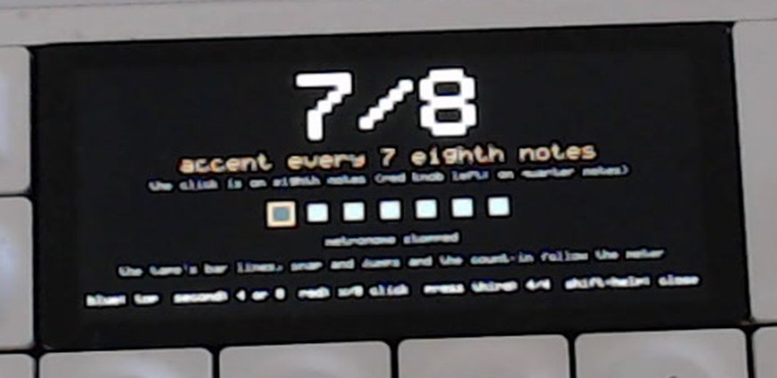

# meter

An [open-field](https://github.com/LaP0573/open-field) pack for the OP-1 Field on OS 1.7.3: **meters other than 4/4, followed by the metronome's accent, the count-in and the tape's bar lines, grid, snap and jumps, with x/8 meters clicking on eighth notes.**



*A webcam photo of the unit's screen: meter's page at 7/8 with the click on eighth notes. The seven squares are the clicks of one bar, the first marked for the accent. The metronome is stopped.*

meter gives the unit a meter from 1/4 to 16/4 or from 1/8 to 16/8. You choose it on a page of the pack's own, and it is kept with the tape. The metronome accents the first click of each bar, an x/8 meter clicks on eighth notes, the count-in is one bar of the meter, and the tape's bar lines, grid lines, snap and jump keys go by the meter. At 4/4 the pack hands every decision back to the firmware. It changes eight places of the firmware: `source/profile.json` lists them as addresses, lengths and checksums, and holds no byte of the firmware.

## Use

1. Hold **shift** and press **help**, in any mode: the page opens. The same again closes it.
2. Set the meter with the knobs.
3. With the unit's metronome on, play the tape: the click and its accent follow the meter, and the page shows which click of the bar is playing.
4. For a count-in, press **shift + record** (with COUNT IN on in the unit's settings): the count-in is one bar of the meter, and the tape then records until you press stop.

| Control | What it does |
| --- | --- |
| Blue knob | The top number, 1 to 16 |
| Second knob | The bottom number: 4 (left) or 8 (right) |
| Red knob | The click of an x/8 meter. Right: on eighth notes (as the pack starts). Left: on quarter notes. It does nothing in an x/4 meter |
| Press the third knob | Back to 4/4 |

The tape draws its grid, and the jump keys go by it, only while the tempo is not set to free: that is the unit's own rule. The full guide, with what each grid setting shows in each meter, is [docs/meter.md](docs/meter.md).

## Status

Tried on a unit on 2026-11-25: OS 1.7.3, open-field 0.19 (base 37); it also starts on open-field 0.21 (base 39). The tests were run by remote control over USB: keys and knobs sent as MIDI, the unit's log, its USB audio, and a webcam on the screen. The metronome's click is not in the unit's USB audio, so the clicks were heard through a microphone, and there is no recording here.

What that showed:

- **The page** opens with shift + help. The blue, second and red knobs and the press of the third work; each change is logged and kept with the tape. The page's text is right in 3/4, in 7/8 (both clicks) and in 12/4.
- **The click**, with the tape playing at tempo 100 for 7.2 s each: 7/8 on eighth notes gave 25 clicks and 4 accents, 7/8 on quarter notes 12 and 2, 6/8 on eighth notes 25 and 4, 3/4 12 and 4, 5/4 13 and 2, 4/4 12 and 3. All are as the meter says.
- **The count-in** is one bar of the meter's clicks: 3 in 3/4, 5 in 5/4, 6 eighth notes in 6/8, 7 eighth notes in 7/8, 7 quarter notes in 7/8 on quarter notes, 12 in 12/4 and 4 in 4/4, all evenly spaced. The eighth-note click after it is even, with none doubled or missing. The popup shows and the tape waits.
- **Recording after the count-in**: shift + record starts the count-in by itself, and the tape then records until stop, in 4/4 and in 7/8. Played back, each take held all six notes played into it. A press of play during the count-in turns the take into plain play: that is the unit's own behaviour, not the pack's.
- **The tape**: in 3/4, 5/4, 6/8 and 7/8, at all four grid settings, the pack gave the firmware the designed lines to a bar, line spacing and snap unit (16 of 16). At 4/4 it gave nothing and left the firmware alone. By eye, the bar lines in 3/4 stand three quarters as far apart as in 4/4 and every third beat line is a bar line; in 5/4 every fifth. The place for winding answered with the 7/8 bar in 7/8 (8 of 8). The jump keys reached the pack on every jump, with no freeze.

Not checked: the click's accent by ear (through the microphone every click sounded alike), where each jump lands (the unit sends no position), a drop onto a grid line, and the grid's look in meters other than 3/4 and 5/4.

## Install

Tick it on open-field's install page once it is listed there, or copy `meter.pack` into the unit's `packs` folder in disk mode and restart.

If the unit does not start with it, hold the **help** key while switching on: it then starts with no packs, and you can delete the file in disk mode.

It needs open-field 0.12 or later and no other pack; there is nothing else to copy. To remove it, delete `meter.pack` and restart: everything is then the stock unit's, and the unit ignores the meter kept in a tape.

## Limits

- OS 1.7.3 only. Each of the eight places has a checksum; on any other firmware a checksum fails and open-field leaves the whole pack out.
- The unit's tempo stays in quarter notes: 6/8 at tempo 120 clicks 240 eighth notes a minute. If that is too busy, turn the red knob to the left.
- An x/8 meter with an odd top number, clicked on quarter notes, is accented every two bars (7/8: every 7 clicks), because a bar is not a whole number of quarter notes.
- The count-in's accent is on its last click, as the unit has it in 4/4.
- Bar 1 is always at the tape's start; that is the unit's own and cannot be moved.
- After starting the tape in the middle of a beat, the first click is the next quarter note. With the tape running backwards the click is on quarter notes.
- No bar numbers on the tape (the unit shows none). MIDI clock and song position carry no meter, so nothing there changes.
- Where a grid setting's usual line does not fit the bar, the next finer one that does is drawn, so two settings can look alike in some meters.

## Files

| File | What |
| --- | --- |
| `meter.pack` | The pack, version 4: 18,060 bytes, SHA-256 `c8392e6d8fc9532eab1a6fdb619da27f03c100147b3fe21f1d23231c2510a4a4` |
| `source/recipe.json` | Its name, version and sources |
| `source/profile.json` | Its eight places in the firmware: addresses, lengths and checksums. No byte of the firmware |
| `source/meter_table.s` | Its table of changes, made from `profile.json` by open-field's `tools/table_build.py` |
| `source/meter.cpp` | The pack: the meter, the click, the count-in, what it gives the tape, the page |
| `source/meter_tables.h` | What the pack gives the tape's grid for each meter and grid setting |
| `source/meter_hook.s` | The routine at the metronome's beat function |
| `source/meter_tape.s` | The four routines by which the tape follows the meter |
| `source/meter_countin.s` | The count-in's two routines |
| `source/meter_card.s` | Made from `recipe.json` by open-field's `tools/pack_build.py`: the pack's card |
| `docs/meter.md` | The full guide |
| `media/` | Two photos of the unit's screen |
| `LICENSE` | MIT |

## Build

Copy `source/` into an open-field tree as `examples/meter/`, then:

```bash
python -I tools/pack_build.py build3 --recipe examples/meter/recipe.json --profile examples/meter/profile.json --out out/meter.pack
```

Built this way against open-field 0.21, it comes out byte for byte as the file here.

Unofficial; not made, endorsed or supported by Teenage Engineering. MIT licence.
