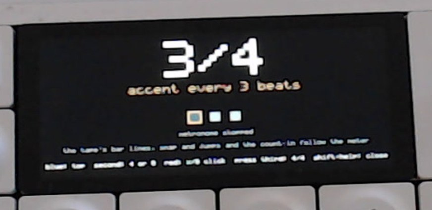
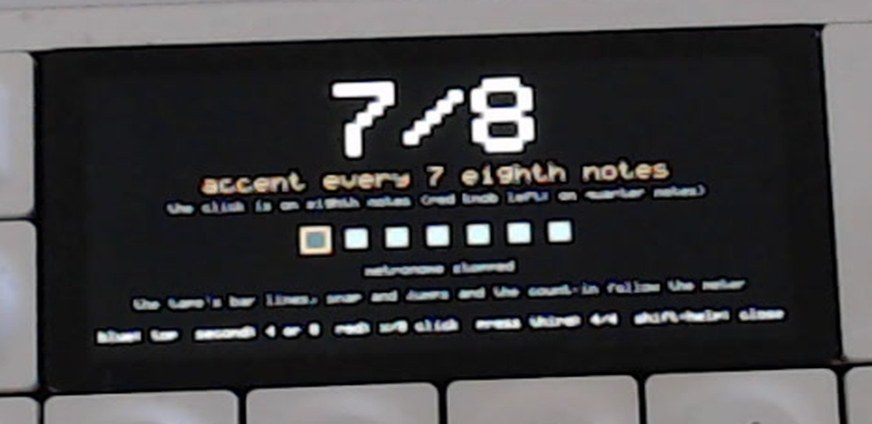

# meter: the guide

meter is an [open-field](https://github.com/LaP0573/open-field) pack that gives the OP-1 Field a meter other than 4/4: 1/4 to 16/4 and 1/8 to 16/8. You choose it on a page of the pack's own, and it is kept with the tape.

- **The metronome** accents the first click of each bar of the meter.
- **An x/8 meter clicks on eighth notes**, with the accent on the first eighth note of each bar. You can set it back to quarter notes.
- **The count-in is one bar of the meter**, not four beats, and its popup counts along.
- **The tape follows the meter**: its bar lines stand at the meter's bars, its grid lines at the meter's beats, the keys that jump along the tape go by them, and winding the tape by hand stops at the meter's bars.

This guide is for `meter.pack` version 4 (18,060 bytes, SHA-256 `c8392e6d8fc9532eab1a6fdb619da27f03c100147b3fe21f1d23231c2510a4a4`). It is for OS 1.7.3 only, under open-field 0.12 or later.

## The page

Hold **shift** and press **help**, in any mode, to open it; again to close it.

- **Blue knob:** the top number, 1 to 16.
- **Second knob:** the bottom number, 4 (left) or 8 (right).
- **Red knob:** the click of an x/8 meter. To the right: on eighth notes (as the pack starts). To the left: on quarter notes. It does nothing in an x/4 meter.
- **Press the third knob:** back to 4/4.

The page shows the meter large, how often the accent comes (`accent every 3 beats`, `accent every 7 eighth notes`), a square for each click of the bar with the first one marked, and, while the metronome runs, the click being played (`beat 2 of 3`). In an x/8 meter a line under the accent says where the click is. The last line names the knobs.



*A webcam photo of the unit's screen: 3/4, three clicks to a bar, the metronome stopped.*



*A webcam photo of the unit's screen: 7/8 with the click on eighth notes, seven clicks to a bar.*

On the unit's tempo screen the meter is shown small, at the top right.

## At 4/4 nothing changes

At 4/4 the pack hands every decision back to the firmware: the metronome, the count-in, the grid, the snapping, the jumps and the winding are the unit's own.

## The click

M is the meter's top number.

| Meter | The click | The accent |
| --- | --- | --- |
| x/4 | on quarter notes, as the unit's | every M clicks: the first beat of each bar |
| x/8, on eighth notes | on eighth notes: two clicks to the unit's one | every M clicks: the first eighth note of each bar |
| x/8, on quarter notes, M even | on quarter notes | every M/2 clicks (6/8: every 3) |
| x/8, on quarter notes, M odd | on quarter notes | every M clicks: every **two** bars (a bar is not a whole number of quarter notes) |

The unit's tempo is still in quarter notes: 6/8 at tempo 120 clicks 240 eighth notes a minute. If that is too busy, turn the red knob to the left.

After starting the tape in the middle of a beat, the first click is the next quarter note.

## The count-in

One bar of the meter's clicks: 3 clicks in 3/4, 5 in 5/4, 7 eighth-note clicks in 7/8. The popup counts 1 to that number. The accent is on the **last** click, as the unit has it in 4/4 (there the fourth click is the accented one). With an x/8 meter on quarter notes the count-in is as many clicks as the accent's period (3 for 6/8, 7 for 7/8).

To record with a count-in, press **shift + record**, with COUNT IN on in the unit's settings. The count-in starts by itself, and the tape then records until you press stop. Do not press play: a press of play, during the count-in or after it, turns the take into plain play. That is the unit's own behaviour, at 4/4 too.

## The tape

The tape draws its grid, and the jump keys go by it, **only while the tempo is not set to free**. That is the unit's own rule and the pack does not change it. The grid has four settings, coarse to fine; the firmware steps through them on **shift + stop**.

What each setting shows in a meter:

| Grid setting | 4/4 (the unit's own) | 3/4 | 5/4 | 6/8 | 7/8 |
| --- | --- | --- | --- | --- | --- |
| 1 | a line a bar | a line a bar (3 beats) | a line a bar (5 beats) | a line a bar | a line a bar |
| 2 | a line every 2 beats | a line a beat | a line a beat | a line every dotted quarter (2 to a bar) | a line every eighth note |
| 3 | a line a beat | a line a beat | a line a beat | a line a beat | a line every eighth note |
| 4 | a line every half beat | a line every half beat | a line every half beat | a line every eighth note | a line every eighth note |

**Bar lines** are drawn in their own colour, as the unit draws them at 4/4, and they always stand at the meter's bars: every third beat line in 3/4, every seventh eighth-note line in 7/8. Where a setting's usual line does not fit the bar (half notes in 3/4), the next finer one that does is drawn, so two settings can look alike in some meters.

- **Jumping** (the firmware's shift + rewind and shift + forward): to the grid line before or after. At grid setting 1 that is a bar of the meter.
- **Dropping**: a drop within about a tenth of a second of a grid line lands on the line, as on the unit; the lines are now the meter's.
- **Winding by hand**: the tape pauses at each bar of the meter (the unit pauses at four-beat bars).

Bar 1 is always at the tape's start; that is the unit's own and cannot be moved. With the click on eighth notes the accent and the bar lines agree in every meter.

## Kept with the tape

The meter is kept as a value called `meter` inside the tape's own file: the meter, and for an x/8 meter the click. For 7/8 on eighth notes it reads `{"bottom":8,"click":8,"top":7,"version":1}`. Load another tape and you get that tape's meter. A new tape, or a tape from before the pack, is 4/4. A value with an x/8 meter and no `click` clicks on eighth notes. The unit ignores the value when the pack is not there.

## What it does not do

- No bar numbers on the tape (the unit shows none). MIDI clock and song position carry no meter, so nothing there changes.
- With the tape running backwards the click is on quarter notes.
- It does not move bar 1, and it does not draw a grid while the tempo is set to free.

## What it changes of the firmware

Eight places of OS 1.7.3, each eight bytes long. `source/profile.json` lists them: for each its address, its length and a checksum of the firmware's bytes there. No byte of the firmware is in that file or in any other file here. open-field's loader makes the changes in the running firmware at the start, after it has checked every checksum; on any other firmware a checksum fails and the loader leaves the whole pack out.

| Address | What stands there | What the pack does |
| --- | --- | --- |
| `0x8f00ef54` | The first instruction of the metronome's beat function | Lets the function run once, then gives its caller 1 on the first click of a bar of the meter and 2 on any other |
| `0x8fc83362` | In the tape grid's function: the call that makes the count of lines to a bar from the grid setting | Gives the count of lines to a bar of the meter |
| `0x8fc8338e` | Later in the same function: the call of the divide for the line spacing | Hands the divide its own dividend |
| `0x8fc9f19a` | In the function that gives the grid and snap unit: the call of the same divide | Hands it the dividend for one grid line of the meter |
| `0x8c0c2ca2` | Where winding the tape by hand looks for the bar to stop at: the call of the same divide | Hands it the dividend for a bar of the meter |
| `0x8f01fd00` | The first instructions of the count-in's step function | Lets the function run once, then sets the count-in's length and keeps the pack's own copy of the count-in's record |
| `0x8f00f180` | In the metronome's tick: the load of the address of the count-in's record | The tick reads the pack's own record instead |
| `0x8fc5fc64` | In the draw function of the count-in's popup: the load of the number it prints | Sets the number first, so that the popup counts 1 to the number of clicks |

At seven of the places the loader keeps a copy of the firmware's own eight bytes in a room of the pack's memory on the unit, and the firmware's code still runs from there. At the eighth (`0x8f00f180`) only the address that is loaded changes. For 4/4 and 8/8 the four tape places give the firmware nothing of the pack's, and at four quarter-note clicks the pack's count-in record is a copy of the firmware's.

## How it works

**The accent.** The firmware's beat function answers the number of the quarter note the tape is in, or -1 when no new beat began. Its caller, the metronome's tick, clicks for any answer but -1 and accents every fourth. The pack lets the function run and then answers 1 for the first click of a bar of the meter and 2 for any other, so that the caller's own test puts the accent there.

**The click on eighth notes.** When a quarter note begins, the pack works out where the off-beat eighth note is due: half a beat on, in the tape's own positions. When the tape has reached that position, it has the metronome click once more. So both kinds of click stand on the tape's positions. When the tape stood still or a count-in ran, no off-beat is clicked until the firmware tells the next quarter note.

**The count-in.** The firmware counts a count-in in frames, four beats long, and its metronome accents the click at which no beat is left. Its popup prints 4 minus the beats left. The pack sets the length to the meter's clicks, keeps a record of its own for the metronome to read, with the accent on the last click and nowhere else, and sets the popup's number so that it counts 1 to the number of clicks. A count-in that is running when the meter changes goes on as it began.

**The tape.** The firmware makes the grid from the grid setting: the lines to a bar, the line spacing, the snap unit, and the bar that winding stops at. At each of the four places the pack gives its own count or dividend, from a table with a row for each meter and grid setting (`source/meter_tables.h`).

The pack's own code divides nothing and does no floating-point arithmetic: the table holds the numbers ready-made.

## What was tried on a unit

On 2026-11-25, on a unit with OS 1.7.3 and open-field 0.19 (base 37), as one of 16 packs running, by remote control over USB: keys and knobs sent as MIDI, the unit's log, its USB audio, and a webcam on the screen. The metronome's click is not in the unit's USB audio, so the clicks were heard through a microphone. The same day the unit was moved to open-field 0.21 (base 39): meter starts there too, with no trouble line in the log.

| Check | Result |
| --- | --- |
| The page (shift + help), the blue, second and red knobs, the press of the third | Work; each change logged and kept with the tape |
| The page's text | Right in 3/4, 7/8 (both clicks) and 12/4 |
| Clicks with the tape playing, tempo 100, 7.2 s each | 7/8 on eighth notes 25 clicks, 4 accents; 7/8 on quarter notes 12, 2; 6/8 on eighth notes 25, 4; 3/4 12, 4; 5/4 13, 2; 4/4 12, 3: all as the meter says |
| The count-in | One bar of the meter's clicks: 3 in 3/4, 5 in 5/4, 6 eighth notes in 6/8, 7 eighth notes in 7/8, 7 quarter notes in 7/8 on quarter notes, 12 in 12/4, 4 in 4/4, all evenly spaced. The popup shows and the tape waits |
| The eighth-note click after the count-in | Even, none doubled or missing |
| Recording after a count-in, 4/4 | Shift + record alone: the count-in, then the tape records until stop. Played back: all six notes played into it |
| Recording after a count-in, 7/8 on eighth notes | The same, with the pack's count-in of 7 clicks. Played back: all six notes |
| A press of play during the count-in, 4/4 | The count-in runs to its end, then the tape plays without recording: the unit's own behaviour |
| The tape's three grid places in 3/4, 5/4, 6/8, 7/8 at all four grid settings | 16 of 16 give the designed lines to a bar, line spacing and snap unit |
| 4/4 | Left to the firmware: the pack gave nothing |
| The tape's grid, by eye | In 3/4 the bar lines stand three quarters as far apart as in 4/4 and every third beat line is a bar line; in 5/4 every fifth |
| The place for winding, in 7/8 | Gave the 7/8 bar (8 of 8) |
| The jump keys (shift + rewind, shift + forward) | The pack was asked on every jump; no freeze |

Not checked on the unit:

- The click's accent by ear: through the microphone every click had the same level and colour.
- Where each jump lands (the unit sends no position).
- A drop onto a grid line.
- The grid's look in meters other than 3/4 and 5/4.
- The numbers the count-in's popup shows.

Before the unit, the pack was checked on a computer, last by running the firmware's own tape, metronome and count-in code in an emulator with the pack in place.

## Lines in the unit's log

Its own lines, tag `meter`. At each change of the meter, once the knobs rest:

```
meter: now 3/4, an accent every 3 beat(s)
meter: now 7/8, the click on eighth notes, an accent every 7 eighth note(s)
```

From time to time it also writes three lines of counts: the beats and accents the metronome was given, how often each of the tape's four places was asked and what it was given last, and the count-ins and their clicks.

## Install and remove

Tick it on open-field's install page once it is listed there. Or, by hand: copy `meter.pack` into the folder `packs` on the unit in disk mode (over an older `meter.pack`, if there is one), and switch the unit off and on.

To remove it, delete `meter.pack` and switch off and on: everything is then the stock unit's. If the unit ever hangs at the start, hold **help** while you switch it on (no pack runs) and delete the pack in disk mode.

## Versions

- Version 1: the metronome's accent follows the meter. One place of the firmware.
- Version 3: the tape follows the meter. Four more places. (Version 2 only watched those places and is gone.)
- Version 4, this one: an x/8 meter clicks on eighth notes, and the count-in is one bar of the meter. Three more places.

The value kept with the tape has the same form in all of them; version 4 adds `click` for an x/8 meter.

## The source

| File | What |
| --- | --- |
| `source/meter.cpp` | The meter, the click, the count-in, what the tape is given, the page, the value kept with the tape |
| `source/meter_tables.h` | For each meter and grid setting, what the pack gives the tape's grid |
| `source/meter_hook.s` | The routine at the metronome's beat function |
| `source/meter_tape.s` | The four routines at the tape's places |
| `source/meter_countin.s` | The routine at the count-in's step function and the one at the popup's number |
| `source/profile.json` | The eight places: addresses, lengths, checksums |
| `source/meter_table.s` | The table of changes for the loader, made from `profile.json` by open-field's `tools/table_build.py` |
| `source/recipe.json`, `source/meter_card.s` | Name, version and sources; the pack's card, made from the recipe by open-field's `tools/pack_build.py` |

The comments in the sources name some files of the working project (notes, test programs, the table's generator) that are not in this repository.

To build, see the README.

Unofficial; not made, endorsed or supported by Teenage Engineering. MIT licence.
